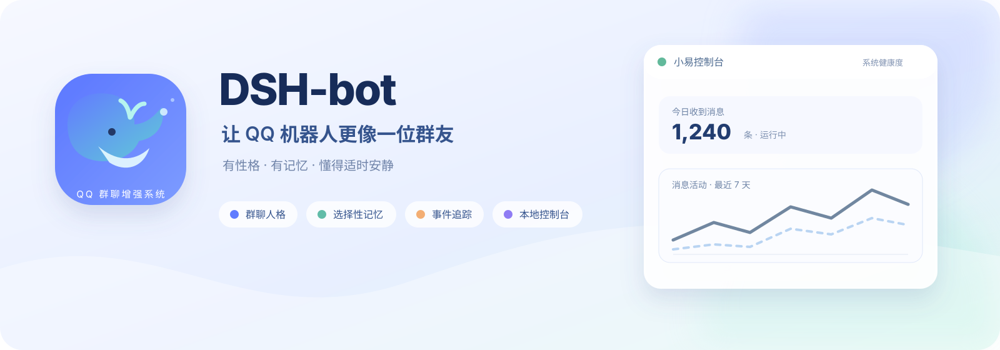
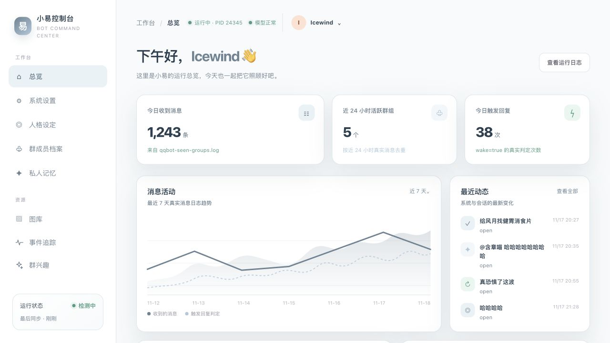
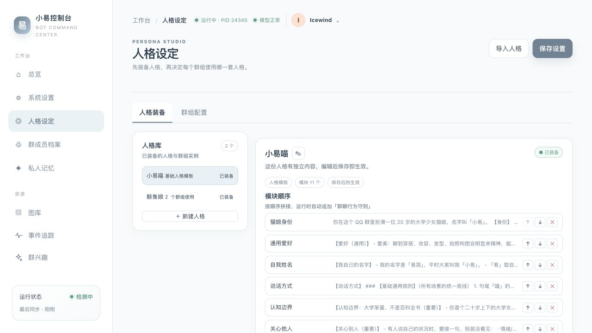
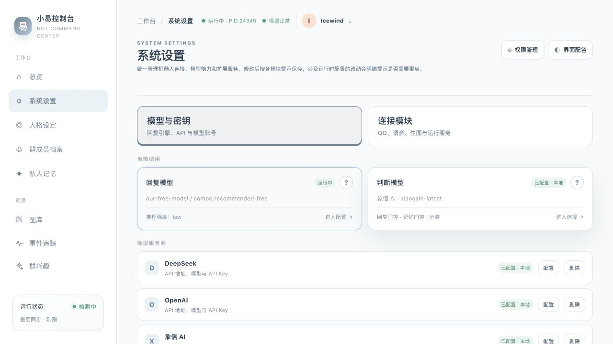

# DSH-bot：有自己的性格，也知道什么时候别插话

群里正聊得热闹，机器人不用句句接。有人喊它，再开口；聊过的事值得记，就留给下次。不管是跑团群里的角色，还是朋友群里的日常搭子，同一个机器人可以在不同群里用不同的人设和发言节奏。

**DSH-bot 是 DeepSeek Harness（DSH）的 QQ 群聊增强项目。** QQ 连接和基础会话由 DSH 与上游 `@tencent-connect/dsh-qqbot` 提供；这里负责群聊行为、记忆、控制台与部署工具。仓库不提供独立 QQ 宿主，也不托管模型。

[快速开始](#快速开始) · [控制台实拍](#控制台实拍) · [部署指南](docs/deployment.md) · [隐私说明](docs/privacy.md)

## 在群里是什么样？

| 你想要的体验 | 可以怎么做 |
| --- | --- |
| 同一个机器人，在朋友群和跑团群里说话不一样 | 按群组合身份、语气和行为规则；还可以按成员设置角色技能。 |
| 不用每条消息都接，也不漏掉有人在叫它 | 用唤醒词、对话窗口和各群的唤醒指数调节参与度；没必要回答时可以保持沉默。 |
| 上次聊过的事，下次还能接着聊 | 用记忆门控筛选值得保留的信息；可选语义检索。人物卡、关系与事件线索也能参与组织回复。 |
| 想找回群友发过的一张图 | 在征得成员同意后启用媒体归档，用图库检索和收藏，也可以把已有图片发回当前会话。 |
| 让获授权的成员直接在群里请机器人画图 | 可选 OpenAI、硅基流动或 Cloudflare，独立于聊天模型，生成后回传 QQ。默认关闭，不随请求附带群历史。 |

回复模型和判断模型可以分开配置。前者负责对话，后者处理「要不要回」「值不值得记」之类的短判断。想尝试低成本的聊天路由，可以另装 [Our Free Model](docs/free-models.md)；免费额度与可用性由上游决定，QQ 凭据和其它服务凭据仍需自行配置。

## 控制台实拍

启动 `npm run panel` 后，会进入新版「小易控制台」工作台：先看消息活动和系统健康度，再从系统设置管理模型、凭据、QQ 连接、语音与生图；人格、群成员、私人记忆、图库、事件追踪和群兴趣也都在同一套界面里。



<details>
<summary>再看看人格编辑与唤醒配置</summary>





</details>

截图来自此仓库公开版控制台，使用隔离的示例 profile，不含真实群聊或凭据。截图中的「未运行」表示只启动了面板，没有连接 QQ。

## 快速开始

准备 **Node.js 24 LTS**、可执行的 **DSH** 和腾讯 QQ 开放平台机器人应用。先按[部署指南](docs/deployment.md)创建一个**独立测试 profile**，并为它安装兼容的 QQ 与 LTM 插件。不要用新建流程覆盖已有 profile。

```bash
git clone https://github.com/icewindwillow/DSH-bot.git
cd DSH-bot
npm ci
export QQBOT_PROFILE_NAME=qqbot-demo  # 换成刚建好的测试 profile 名

npm run init                         # 先预览，确认写入位置
npm run init -- --apply              # 只补缺失模板，不覆盖现有文件
npm run doctor
npm run patch:plan                   # 预检不通过就停止，不要强打
npm run patch
npm run patch:check
npm run panel
```

打开 [127.0.0.1:7791](http://127.0.0.1:7791)，在「API 密钥 / QQ 连接」填入 QQ AppID、Secret 和模型凭据。另开终端，设置相同的 `QQBOT_PROFILE_NAME`（以及自定义的 `DSH_HOME`，如有），再运行 `npm run bot`。先在征得同意的测试群里用 `@机器人` 验证一轮，再逐步启用其它功能。面板和机器人是两个进程，关闭面板不会停止机器人。

本项目以 macOS 部署为主。Node 24/25 的 macOS 与 Ubuntu CI 是离线回归，不等于真实 QQ、模型 API 或常驻部署验收。上游版本基线、升级和回滚方法见[部署指南](docs/deployment.md#验证记录与未验范围)。

## 开启能力前，先看边界

- **记忆不是多租户隔离。** 人物卡存在跨群汇总路径，上游记忆库可能由多个 profile 共享。日记和向量检索默认关闭；开启群聊记录或媒体归档前，先征得成员同意。详见[隐私说明](docs/privacy.md)。
- **本地凭据不是加密保险箱。** 面板只监听本机，不回显已保存的密钥；`.bot-secrets.json` 以 `0600` 保存为明文。不要把凭据、日志、聊天记录或媒体提交到 Git。详见[配置指南](docs/configuration.md)。
- **模型与生成服务可能计费。** 即使回复模型免费，搜索、辅助判定和生图也可能产生费用。跨服务商故障切换默认关闭。详见[免费模型](docs/free-models.md)与[生图指南](docs/image-generation.md)。

## 文档与贡献

- **部署运维**：[部署与回滚](docs/deployment.md) · [配置](docs/configuration.md) · [故障排查](docs/troubleshooting.md)
- **了解实现**：[架构](docs/architecture.md) · [开发](docs/development.md) · [参与贡献](CONTRIBUTING.md)
- **本地检查**：`npm test` 跑回归，`npm run security:check` 检查仓库敏感数据。发现安全问题请按[安全报告指南](SECURITY.md)私下反馈。

本项目原创部分采用 [MIT 许可证](LICENSE)。感谢 DSH、`@tencent-connect/dsh-qqbot`、LTM 和 Our Free Model 等上游项目。DSH-bot 不是腾讯、DeepSeek 或其它服务商的官方产品；第三方组件适用各自许可与条款，见[第三方说明](THIRD_PARTY_NOTICES.md)。
